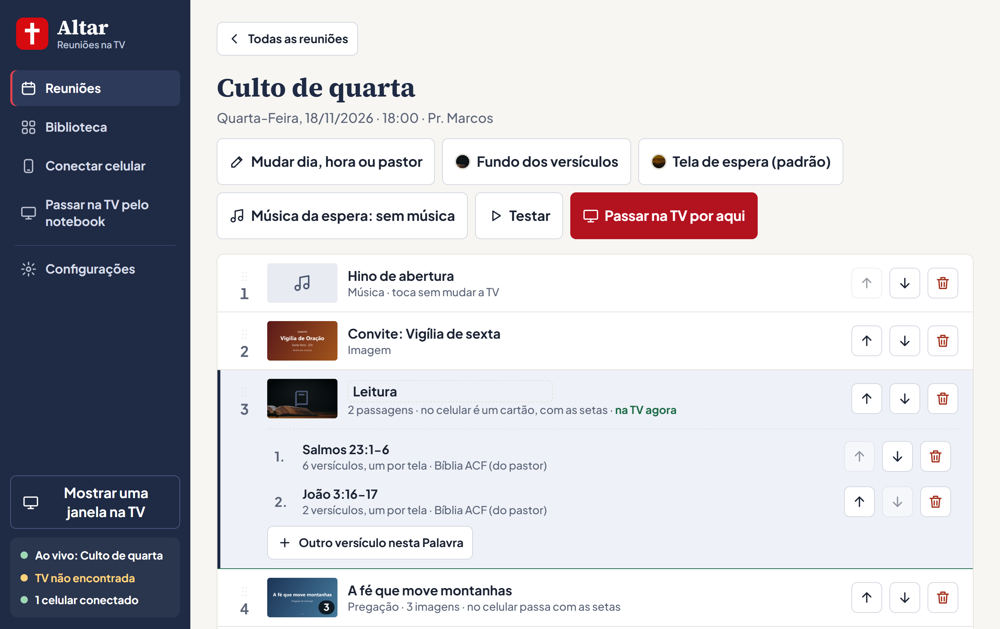
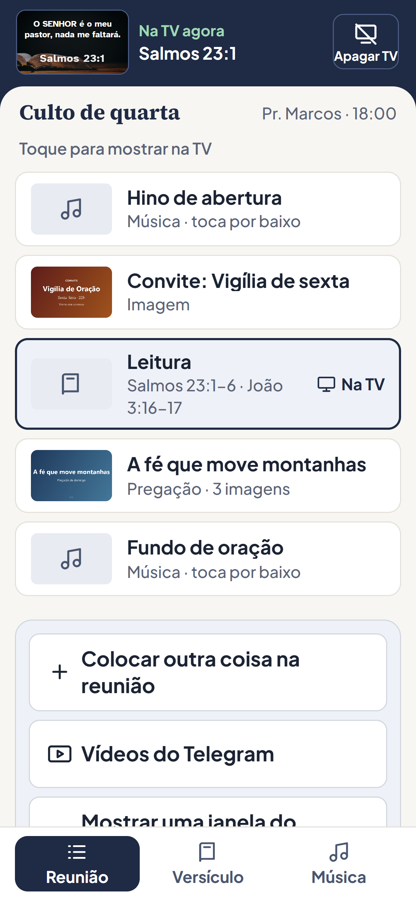

# Altar

**Programa para conduzir as reuniões da igreja pelo celular, projetando na TV.**

O pastor prepara a reunião no notebook (vídeos, imagens, músicas, pregação e versículos da Bíblia) e, na hora do culto, conduz tudo pelo celular: toca no cartão e o conteúdo aparece na TV. O celular não instala nada, só lê um QR code.

> Projeto voluntário, feito para a minha igreja e usado nas reuniões. Os usuários são pastores, alguns de idade e com pouca familiaridade com tecnologia. Por isso a simplicidade da interface foi o principal requisito.


## O problema

Antes, conduzir uma reunião exigia alguém no computador abrindo arquivos, trocando janelas e procurando versículos, e muitas vezes a tela do Windows aparecia na TV. Transmitir direto do celular (Chromecast, espelhamento) era instável e difícil para quem não tem costume com tecnologia.

## A solução

| Tela | Onde | Para que serve |
|------|------|----------------|
| **Painel** | Notebook | Preparar a reunião: escolher os itens, a ordem, os versículos e os arquivos da Biblioteca |
| **Telão** | TV (cabo HDMI) | Mostrar só o conteúdo, em tela cheia, nunca a área de trabalho |
| **Controle** | Celular do pastor | Conduzir a reunião: cartões grandes, um toque leva o item à TV |



## Funcionalidades

- **Reunião em cartões:** vídeos, imagens, músicas, pregação (várias imagens com ◀ ▶) e convites
- **Aba "Música" do celular:** tocar numa música começa a tocar sem sair da aba; no alto fica o "Tocando agora" com pausar e parar; a lista vem em ordem alfabética, com as favoritas primeiro. Ao lado de cada música, o botão "⋯" abre as opções dela: favoritar (também dá para favoritar na Biblioteca do notebook), renomear e "Colocar na reunião" (vira um cartão e fica salva). A música colocada passa a aparecer no alto da aba, no grupo "Desta reunião"; ali o "⋯" tem "Tirar desta reunião", que pergunta antes e deixa a música na Biblioteca.
- **A reunião lembra de onde parou:** se o programa do notebook fechar sem querer (ou o notebook reiniciar) e abrir de novo em até 30 minutos, a TV volta como estava: o mesmo versículo, imagem ou pregação, e o vídeo ou a música no ponto em que estavam. O celular, ao abrir de novo, também volta para o que está na TV. "Encerrar reunião" apaga essa memória.
- **O celular lembra de quem ele é:** na primeira vez, o celular pergunta o nome do pastor (toca na lista ou escreve; nome novo entra na lista de pastores do notebook) e guarda. O nome aparece no alto da tela, só para o pastor ver que o celular é o dele: dois pastores podem mexer na mesma reunião, e ninguém escolhe "quem vai conduzir"
- **Arrumar a reunião pelo celular:** em "Mudar a ordem ou tirar um item", o pastor arrasta os itens pelas três barrinhas para mudar a ordem, ou tira um item pela lixeira (o que está na TV não sai; o arquivo continua na Biblioteca). O botão de voltar do celular volta uma tela por vez e só sai do aplicativo na tela inicial
- **Pregação a partir de imagens, PDF ou PowerPoint:** várias imagens marcadas (na Biblioteca ou no celular) viram uma pregação só; no notebook dá para subir, descer, tirar e colocar imagens. O PowerPoint é aberto pelo PowerPoint do próprio notebook (ou pelo LibreOffice); sem nenhum dos dois, o programa pede o arquivo em PDF
- **Bíblia embutida (ACF, ARC e NVI):** passagens preparadas antes e **versículo avulso** escolhido na hora, com fundos de imagem. No celular, o versículo que está na TV aparece em destaque para o pastor ler, e um toque troca a versão (vale até o fim da reunião). Na TV, a letra tem contorno e o fundo escurece atrás do texto
- **Controle pelo celular sem instalar app:** funciona em Android e iPhone pelo navegador, pela rede Wi-Fi local, sem depender de internet
- **Envio de arquivos pelo celular** direto para a Biblioteca do notebook
- **Fotos e vídeos do Telegram:** as conversas aparecem como no Telegram (pessoas, grupos e canais), no celular e no notebook; o pastor abre uma, toca na foto ou no vídeo e o programa baixa no notebook
- **Janela do notebook na TV** (YouTube, Telegram...): o celular toca, pausa, adianta e mexe no volume só daquele programa
- **Controles de culto:** apagar a TV, volume, tela de espera com a logo da igreja e encerrar
- **Fundo de espera com som:** o vídeo da tela de espera pode tocar com o próprio som (chave "Tocar o som deste vídeo"). Começa quando a reunião é aberta, sai abaixando quando o primeiro item vai para a TV, e o celular pausa e controla o volume. Os fundos ficam na Biblioteca, aba "Tela de espera": **fixo** (sempre o mesmo) ou **sorteado** (um diferente a cada reunião aberta, sem repetir o anterior)
- **Instalador para Windows** que já libera o programa no firewall e abre sozinho quando o notebook liga
- **Acesso protegido:** só quem leu o QR code (que leva uma chave aleatória) consegue controlar a TV



## Tecnologias

- **Electron:** app de desktop para Windows, com o Telão em tela cheia na segunda tela
- **Node.js:** servidor HTTP + **WebSocket** (`ws`) rodando dentro do app, que sincroniza as três telas em tempo real
- **HTML, CSS e JavaScript puros** nas telas, sem framework
- **GramJS:** integração com a API do Telegram (somente leitura)
- **electron-builder (NSIS):** instalador `.exe`
- **node:test:** testes automatizados da lógica principal (condução da reunião, Bíblia, dados, Telegram)

## Arquitetura

```
 Celular (Controle)  ──Wi-Fi──┐
                              ▼
                ┌────────────────────────────┐
                │  Notebook (Electron)       │
                │  servidor HTTP + WebSocket │──HDMI──▶  TV (Telão)
                │  estado da reunião         │
                │  Painel                    │
                └────────────────────────────┘
```

O processo principal do Electron guarda o estado da reunião e serve as três telas como páginas web. Assim, o celular e a TV usam exatamente o mesmo caminho. As decisões de arquitetura estão registradas em [docs/adr](docs/adr) e o vocabulário do domínio em [GLOSSARY.md](GLOSSARY.md).

## Rodar (desenvolvimento)

Os textos da Bíblia (`src/biblia/*.json`) **não estão no repositório**, porque os direitos são das editoras. Antes de rodar, coloque os arquivos na pasta `src/biblia/` (formato e origem em [src/biblia/LEIA-ME.md](src/biblia/LEIA-ME.md)).

```
npm install
npm start
```

- Abre o **Painel** no notebook e o **Telão** na TV (se a TV estiver ligada no cabo; senão, numa janela).
- Na primeira vez, o Windows pergunta sobre a rede: clique em **Permitir** (rede privada).
- No celular (mesmo Wi-Fi): leia o QR code do Painel.

## Testes

```
npm test
```

## Instalador (para o notebook da igreja)

1. Gere o instalador: `npm run instalador` (cria `dist/Instalar-Altar-<versão>.exe`). O comando também gera o aplicativo do celular e coloca dentro do instalador; por isso precisa do Android SDK e do Java 17 ou mais novo.
2. Copie o `.exe` para o notebook da igreja (pendrive) e abra.
3. O Windows avisa "O Windows protegeu o computador" (o programa não é assinado): clique em **Mais informações → Executar assim mesmo**.
4. Pronto: o programa abre sozinho quando o notebook liga (dá para desligar em Configurações → Windows).

Os dados (reuniões, Biblioteca, pastores) ficam em `%APPDATA%\altar\dados` e continuam lá ao reinstalar ou atualizar.

### Atualização automática

O programa instalado se atualiza sozinho: logo depois de abrir (e de 6 em 6 horas) ele procura a versão mais nova nas [Releases do GitHub](https://github.com/luizhenriqueperinif/altar/releases), baixa por trás e instala quando o programa fecha. Em Configurações → Atualização do programa dá para ver a versão, procurar na hora e clicar em **Atualizar agora** (o programa fecha e abre de novo). Ele nunca reinicia sozinho, e o botão não funciona com uma reunião aberta.

Para soltar uma versão nova:

1. Suba a `version` no package.json.
2. `npm run publicar` (gera o instalador e publica a Release; precisa do GitHub CLI com login feito, `gh auth login`).

Os notebooks com internet baixam a versão nova sozinhos. Um notebook novo instala uma vez pelo `.exe` da Release mais recente. A instalação manual pede permissão de administrador (regra do firewall); a atualização automática não pede.

Para ensaiar pelo código, sem instalar nada: `ALTAR_TESTAR_ATUALIZACAO=1 npm start` (o programa finge ser uma versão antiga, procura e baixa de verdade, mas não instala).

## Aplicativo do celular (Android)

O celular não precisa de aplicativo: o QR code do Painel abre o controle no navegador. O aplicativo (`android/`) é o mesmo controle em tela cheia, com quatro confortos: guarda o endereço do notebook (o QR code é lido uma vez só; **Desconectar deste notebook**, na tela inicial, esquece o endereço para ler outro QR code), procura o notebook sozinho se o roteador trocar o endereço dele, não deixa a tela do celular apagar durante a reunião e mostra as últimas fotos e vídeos do celular em **Colocar outra coisa na reunião**, para marcar e mandar sem abrir a galeria. As telas continuam vindo do notebook, então atualizar o programa do notebook não exige atualizar o aplicativo (só as novidades que dependem do celular, como essa das fotos, pedem o aplicativo novo).

Para mostrar as últimas fotos e vídeos, o aplicativo pede a permissão do Android para ver as fotos do celular, só quando a pessoa toca no botão. O navegador não consegue fazer isso (uma página não pode listar a galeria), então ali fica só o botão **Neste celular**. As fotos marcadas vão direto do aplicativo para o notebook pareado, pela rede local.

O aplicativo vai dentro do programa do notebook; o pastor não precisa receber nenhum arquivo:

1. Conecte o celular pelo QR code do Painel (abre o controle no navegador).
2. Na tela inicial do controle, toque em **Instalar o aplicativo do Altar neste celular** e depois em **Baixar o aplicativo**. O arquivo vem do próprio notebook (`/app/Altar.apk`), sem internet.
3. Abra o arquivo baixado e instale. O Android pede para permitir a instalação por aquele navegador, porque o aplicativo não vem da loja.
4. De volta ao navegador, toque em **Abrir no aplicativo**: ele abre já conectado. (Ou abra o Altar no celular e toque em **Ler o QR code**.)

**Atualização do aplicativo.** O aplicativo não vem da loja, então não se atualiza sozinho. Quando o programa do notebook traz um aplicativo mais novo que o do celular, a tela inicial do controle (dentro do aplicativo) mostra **Atualizar o aplicativo**: ele baixa o arquivo do notebook e o Android pergunta se pode atualizar. Na primeira vez o Android também pede para permitir que o Altar instale aplicativos. Quem ainda tem o primeiro aplicativo (anterior à 1.1.4) precisa instalar pelo navegador mais uma vez, pelos passos acima. Para o botão aparecer, cada aplicativo novo precisa de um `versionCode` maior em `android/app/build.gradle`.

Para gerar só o APK: `npm run apk` (sai em `android/app/build/outputs/apk/release/app-release.apk`).

O APK é assinado com a chave de desenvolvimento do computador que o gerou. Uma atualização gerada em outro computador não instala por cima: é preciso desinstalar o aplicativo antigo e ler o QR code de novo.

## Autor

Feito por **Luiz Henrique**: [LinkedIn](https://www.linkedin.com/in/luizhperini) · [GitHub](https://github.com/luizhenriqueperinif)

Créditos das fotos de fundo dos versículos: [src/web/comum/fundos/CREDITOS.md](src/web/comum/fundos/CREDITOS.md). As telas acima usam dados de exemplo.
